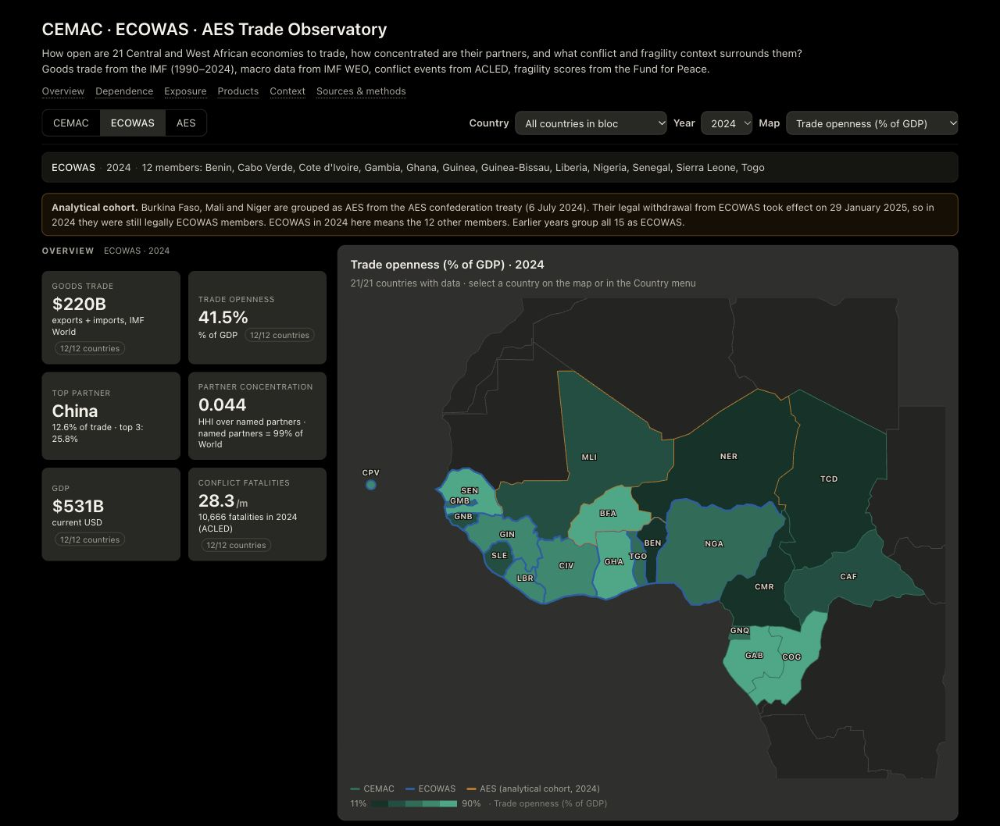
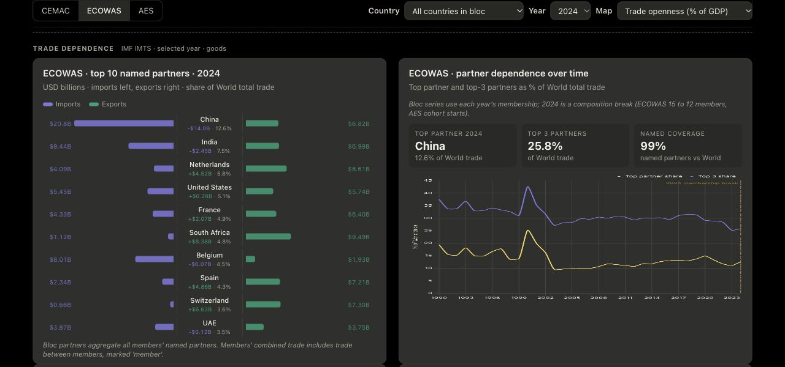
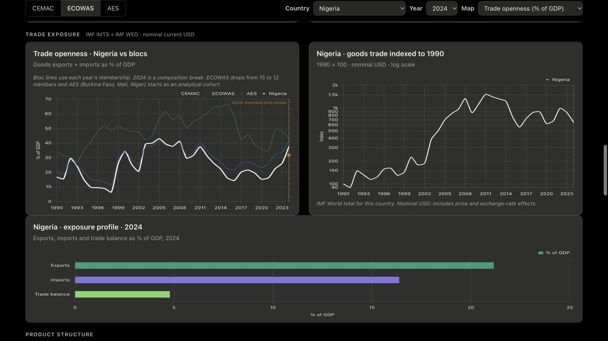

# CEMAC · ECOWAS · AES Trade Observatory

Explore goods trade, partner dependence, economic exposure, conflict and fragility across **21 Central and West African countries**, with annual trade and macroeconomic views for **1990–2024**.

**[Open the live dashboard →](https://cemac-ecowas-aes-trade-observatory.vercel.app/)**  ·  [Methodology](docs/methodology.md)  ·  [Run locally](#run-locally)  ·  [Validation](#validation)

[](https://github.com/mintyfizz/cemac-ecowas-aes-trade-observatory/actions/workflows/deploy-pages.yml)

[](https://cemac-ecowas-aes-trade-observatory.vercel.app/?bloc=ECOWAS&year=2024)

*ECOWAS, 2024. The overview pairs headline indicators with an interactive country map and explicitly explains the analytical AES membership rule.*

## Explore the dashboard

- **Start with a bloc, country and year.** Compare goods trade, openness, GDP, partner concentration and conflict fatalities per million. Coverage badges show which members contribute.
- **Investigate dependence and exposure.** Inspect imports, exports, signed balances and partner shares; compare historical openness and a fixed-cohort trade index.
- **Read the context with its date.** Conflict and fragility panels identify their observation windows. Sources, definitions and unresolved differences are visible in the dashboard.

The URL preserves `bloc`, `year`, `country` and `metric`, so a selected view can be shared directly. The dashboard is static: it reads committed JSON, with no public backend or browser secrets.

### Who are the trading partners?

[](https://cemac-ecowas-aes-trade-observatory.vercel.app/?bloc=ECOWAS&year=2024#section-partners)

*Partner shares use IMF World trade as the denominator. The chart preserves the UAE deficit of $123.8 million and marks the 2024 membership break in the historical series.*

### How does a country compare?

[](https://cemac-ecowas-aes-trade-observatory.vercel.app/?bloc=ECOWAS&year=2024&country=NGA#section-exposure)

*Nigeria, 2024. Openness and the exposure profile are percentages of GDP; the trade index is in nominal USD and includes price and exchange-rate effects.*

Screenshots were captured from the public Vercel dashboard on **18 November 2026**. Their dates identify the capture, not a new source-data release. [Capture record](docs/images/README.md).

## Data and limitations

| Source | Dashboard use | Current coverage / status |
| --- | --- | --- |
| IMF International Merchandise Trade Statistics (IMTS / DOTS) | Goods totals, bilateral partners and concentration | Annual 1990–2024; World rows for headline totals. |
| IMF World Economic Outlook | GDP, population and macro-fiscal indicators | Annual 1990–2024; source-release vintage was not recorded in the preserved snapshot. |
| ACLED | Conflict events and fatalities | Saved events through 2024; context combines 2022–2024. The first observed event year is a coverage heuristic, not confirmed provider coverage. |
| Fund for Peace, Fragile States Index | Fragility total and components | Editions 2006–2023 loaded; latest context is explicitly dated. |
| UN Comtrade | Planned HS2 product structure | **Quarantined** until re-extraction reconciles with matched same-provider totals. |

The preserved raw snapshots were extracted in **May 2026**. This is a historical observatory, not a live data feed.

> **November 2026 correction.** The reviewed release replaces inflated aggregate-based trade totals with IMF World rows, repairs population-scaled conflict rates, consolidates duplicated hotspots, and uses matched reporting countries for ratios. Earlier Comtrade product values did not reconcile; dropped breakdown dimensions are a suspected cause, not an established one. See the [methodology and remaining work](docs/methodology.md).

### Interpretation rules

- **Official totals stay intact.** Named partners can differ from the World total; coverage and signed differences remain visible.
- **Concentration has a stated universe.** HHI uses the full named-partner distribution before ranking. It is conditional on named-partner coverage and is not a risk rating.
- **Comparisons use matching contributors.** Bloc ratios use the same countries in numerator and denominator. Year-on-year changes are suppressed when membership or reporting contributors change.
- **Membership is analytical.** Burkina Faso, Mali and Niger form the AES cohort from 2024, based on the 6 July 2024 confederation. Legal ECOWAS withdrawal took effect on 29 January 2025; the dashboard distinguishes these dates.
- **Missing values remain unavailable.** Pre-coverage conflict years are not zero, and FSI values are never carried backward into earlier years.
- **Historical ambiguity stays visible.** Former and successor partner codes sometimes coexist. Values are preserved and flagged rather than removed or redistributed on an assumption.

## Run locally

No Databricks account or package installation is needed to preview the committed dashboard. Use Python 3 to serve it:

```bash
git clone https://github.com/mintyfizz/cemac-ecowas-aes-trade-observatory.git
cd cemac-ecowas-aes-trade-observatory
python3 -m http.server 8080 --directory static
```

Open [localhost:8080](http://localhost:8080). Chart.js, D3 and TopoJSON load from a CDN, so rendering the dashboard requires an internet connection.

## Architecture and deployment

The current public release uses an offline, reproducible data build:

```text
Preserved IMF / ACLED / FSI raw snapshots
  → scripts/offline_rebuild.py
  → committed static/data/*.json + provenance
  → static HTML / CSS / JavaScript dashboard
  → Vercel production + GitHub Pages mirror
```

**Production:** [cemac-ecowas-aes-trade-observatory.vercel.app](https://cemac-ecowas-aes-trade-observatory.vercel.app/)

**Mirror:** [GitHub Pages](https://mintyfizz.github.io/cemac-ecowas-aes-trade-observatory/)

Vercel serves the `static/` directory as a static site; no install or application build step is required. The GitHub Pages workflow validates the committed output before publishing the same directory. Branch and pull-request checks run separately in `.github/workflows/checks.yml`.

The repository also contains a Databricks bronze → silver → gold lakehouse in catalog `cemac_ecowas_aes_trade`. **The corrected notebooks still need a Databricks rerun and output reconciliation.** The legacy export is guarded and excluded from the current GitHub Pages workflow; unverified gold tables do not replace the reviewed static data.

<details>
<summary>Databricks table reference</summary>

### Bronze

| Table | Source | Role |
| --- | --- | --- |
| `bronze.imts_raw` | IMF IMTS / DOTS | Annual bilateral goods exports and imports, 1990-2024. |
| `bronze.comtrade_hs6_raw` | UN Comtrade | Product trade extract used for HS2 product structure. |
| `bronze.acled_events_historical` | ACLED | Event-level conflict records. |
| `bronze.acled_weekly_aggregated` | ACLED | Country-week conflict rollups. |
| `bronze.imf_weo_raw` | IMF WEO | GDP, debt, fiscal balance, inflation, current account, and related macro indicators. |
| `bronze.fsi_raw` | Fund for Peace FSI | Total and component fragility scores. |
| `bronze.data360_raw` | World Bank Data360 | Reachability and Delta time-travel demonstration; not a dashboard source. |

### Silver

| Table | Role |
| --- | --- |
| `silver.dim_country` | Country metadata, current primary bloc, and names. |
| `silver.dim_bloc_membership` | Time-aware country-to-bloc membership. |
| `silver.fact_macro_annual` | Typed macroeconomic and trade-intensity facts per country-year. |
| `silver.fact_trade_partner_annual` | Bilateral reporter-partner trade totals. |
| `silver.trade_partner_concentration_annual` | Country-level partner HHI. |
| `silver.comtrade_partner_annual` | Bilateral Comtrade partner data for coverage overrides. |
| `silver.comtrade_hs2_annual_w00` | National-total HS2 product data for product structure. |
| `silver.comtrade_product_coverage` | Coverage flags for product chart eligibility. |
| `silver.fact_acled_events` | Clean event-level conflict data. |
| `silver.fact_acled_weekly` | Country-week conflict aggregates. |
| `silver.fact_acled_country_year` | Country-year conflict metrics. |
| `silver.fact_fsi_annual` | Normalized annual FSI scores and components. |

### Gold

| Table | Role |
| --- | --- |
| `gold.country_year_observatory` | Joined country-year observatory record. |
| `gold.country_latest_snapshot` | Latest country snapshot. |
| `gold.bloc_year_observatory` | Bloc-year aggregate observatory record. |
| `gold.bloc_latest_snapshot` | Latest bloc snapshot. |
| `gold.dashboard_country_timeseries` | Map, overview, macro profile, growth, and exposure panels. |
| `gold.dashboard_top_trade_partners` | Partner bars and partner dependence diagnostics. |
| `gold.dashboard_conflict_hotspots` | Operational conflict panel. |
| `gold.dashboard_fragility_components` | FSI component panel. |
| `gold.dashboard_bloc_comparison` | Bloc comparison and trade openness trend. |
| `gold.product_trade_hs2` | HS2 export/import product structure. |

</details>

## Validation

With Python 3 and Node.js installed:

```bash
node --check static/js/charts.js
node --check static/js/app_static.js
node --test scripts/test_partner_bars.cjs
python3 scripts/check_static_contract.py
python3 scripts/test_contract_mutations.py
```

The reviewed release passed **51,227 contract checks**, including a byte-identical raw rebuild on macOS, and caught **all 11 injected defects**. Five renderer tests cover real signed balances, small values, missing values, zeros and proportional bars. Independent source checks and browser verification are recorded in [PR #2](https://github.com/mintyfizz/cemac-ecowas-aes-trade-observatory/pull/2).

To rebuild from preserved raw extractor files (not included in a fresh clone):

```bash
python3 scripts/offline_rebuild.py --raw-dir <raw-snapshot-directory>
python3 scripts/check_static_contract.py --raw-dir <raw-snapshot-directory>
```

The raw contract check verifies that the same inputs reproduce the committed JSON bytes. Rebuilding uses no network and requires no Databricks connection.

## Repository guide

| Path | Purpose |
| --- | --- |
| `static/` | Public dashboard and validated JSON datasets. |
| `scripts/` | Offline rebuild, contract checks, renderer tests and guarded Databricks utilities. |
| `config/` | Pinned IMF counterpart taxonomy and country codes. |
| `extraction/` | Source extractors and ingestion instructions. |
| `00_*.ipynb` … `15_*.ipynb` | Databricks setup, ingestion, transformation, audit and mart notebooks. |
| `docs/methodology.md` | Definitions, source limitations, corrections and remaining work. |
| `docs/decisions/` | Architecture and source-selection decisions. |
| `docs/images/` | Screenshots of the public dashboard and capture provenance. |
| `.github/workflows/` | Contract checks and GitHub Pages publishing. |

## Country scope

| Dashboard scope | Countries |
| --- | --- |
| CEMAC | Cameroon, Central African Republic, Chad, Congo, Equatorial Guinea, Gabon |
| ECOWAS current non-AES members | Benin, Cabo Verde, Côte d’Ivoire, Gambia, Ghana, Guinea, Guinea-Bissau, Liberia, Nigeria, Senegal, Sierra Leone, Togo |
| AES | Burkina Faso, Mali, Niger |

Historical annual panels group the three AES countries under ECOWAS before 2024. Latest-snapshot panels use current analytical membership.

## Author and license

**Nathan Thomas Gatse** · Thomas More University of Applied Sciences, Belgium.

Original code, notebooks, scripts and documentation use the [MIT License](LICENSE). Source data and derived datasets remain subject to their providers’ terms.
